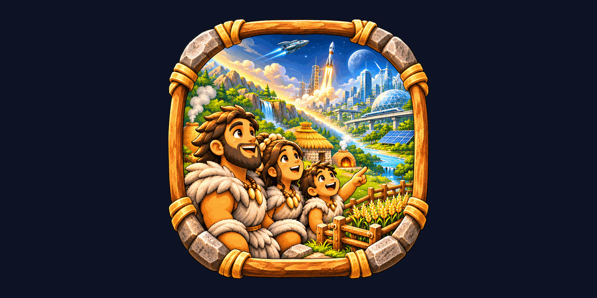

<p align="center"></p>

<h1 align="center">Letopis</h1>

<p align="center"><i>An idle civilization that lives on its own server. You just watch it grow.</i></p>

Letopis (Bulgarian for *chronicle*) is a self-hosted idle simulation. A few families start in the Stone Age
and, with nobody pressing a button, discover fire, tools, farming and everything after. Open the page whenever
you like and see how far they got. The whole game runs in the browser; the world keeps living on the server
while nobody is watching.

## Features

- A generated world with relief, rivers, forests, mountains, seasons and snow, drawn in a cozy isometric pixel-art style.
- Every person has a name, parents, children and traits (strength, wit, curiosity, sociability, health, longevity) that are inherited with small mutations.
- Clans wander, split, meet, learn from each other, settle into villages and sometimes die out together with their knowledge.
- Trees grow and get cut for fires and huts; a clan moves on when the wood around its camp is gone.
- A living chronicle of everything that happens, with clickable people and clans, family trees back to the first humans and a list of first discoveries.
- English and Bulgarian, switchable at any time with the language button.
- Kids mode with bigger letters and simpler explanations.
- "While you were away": the highlights since your last visit.
- Tour mode: the camera wanders the world by itself and stops where something happens. Nice on a TV.
- 100 tiny secrets hidden around every world.

## Pace

About three months of real time take the world from the Stone Age to the present day; after that it keeps going at the same pace.
The Stone Age is the fastest (a year in about 3 minutes), the modern centuries the slowest (a year in about 1.5 hours).
Each discovery has a target date, and its chance rises or falls when the world runs ahead of or behind history.

## Running it

### Docker

```sh
docker run -d --name letopis -p 2222:2222 -v /path/to/letopis-data:/data --restart unless-stopped ghcr.io/leppermesiah/letopis:latest
```

Then open `http://<host>:2222/`.

### Unraid

Docker → Add Container → Template, and use [`unraid/letopis.xml`](unraid/letopis.xml), or fill in by hand:

- Repository: `ghcr.io/leppermesiah/letopis:latest`
- Port: `2222` → `2222`
- Path: `/data` → `/mnt/user/appdata/letopis`

The world is saved every 2 minutes and when the container stops, and continues where it left off after a restart.
If humanity dies out, the world is archived in `/data/archive/` and a new one begins a minute later.

### Settings (environment)

| Variable | Default | Meaning |
|---|---|---|
| `LETOPIS_PORT` | `2222` | web port |
| `LETOPIS_DATA` | `/data` | where the world, the chronicle (SQLite) and the archive live |
| `LETOPIS_SPEED` | `1` | time multiplier, only for testing |
| `LETOPIS_SEED` | random | seed of the first world |
| `TZ` | `Europe/Sofia` | time zone |

## Building from source

Requires Node.js 22.

```sh
npm ci
npm run dev     # runs at x200 speed with data in ./data, http://localhost:2222
npm run build   # production build into dist/
```

### Graphics

The sprites are generated from the prompts in [art/PROMPTS.md](art/PROMPTS.md); the sheets live in `art/sheets/`.
After changing or adding a sheet (needs Python, Pillow and NumPy):

```sh
python3 -I tools/slice_sprites.py   # cuts the sheets into single sprites in art/cut/ and cleans the halos
python3 -I tools/build_atlas.py     # builds public/sprites/atlas*.png and atlas.json
```

The finished atlas is in git, so Python is not needed to build the game.

## API

`/api/health`, `/api/world`, `/api/snapshot`, `/api/chronicle?before=&after=&min=&limit=`, `/api/since?after=`,
`/api/person/:id`, `/api/tree/:id`, `/api/band/:id`, `/api/heroes`, `/api/discoveries`, `/api/stats`, `/api/worlds`, WebSocket `/ws`.
`/api/health` works well as a sensor for Home Assistant or any uptime monitor.

## Roadmap

1. **World and people** (now): terrain, people, clans, the Stone Age up to the first villages, isometric view, chronicle.
2. Settlements and discoveries up to the Iron Age, richer villages.
3. States, trade, wars without on-screen violence, diseases, disasters.
4. Middle Ages to modern times, portraits, more for kids.
5. Space and colonies on other worlds.

## Credits

Everything taken from outside, with its author and license, is listed in [CREDITS.md](CREDITS.md).
